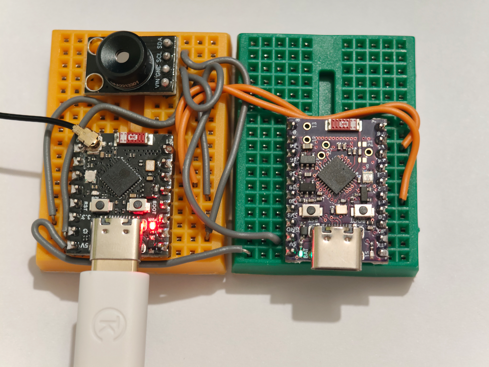
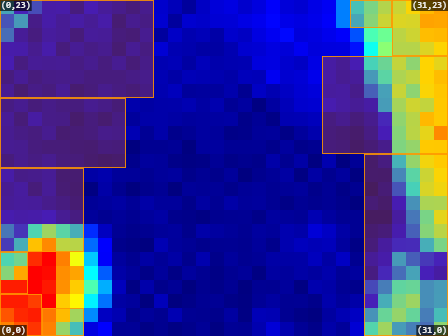
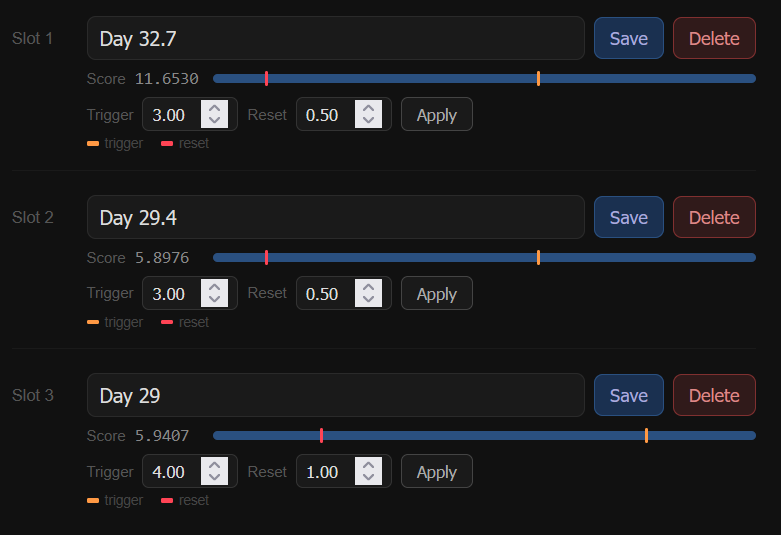

# Introduction

The PERIL presense sensor uses a thermal camera to detect static human presence. This enables it to detect non-moving people with greater reliability than existing radar-based solutions. Presence is reported to Home Assistant over Wi-Fi and Zigbee.

The sensor consists of 2 microcontrollers. An ESP32-C3 handles sensor reading, HA reporting over Wi-Fi and the webserver. An ESP32-C6 handles Zigbee communications.



Detection works by comparing the current thermal image to one of 3 reference images (known as a slot). 



The similarity of the current image to the reference images are represented as a numerical score using the scoring algorithm. The user can configure the threshold at which a match is confirmed. If none of the reference images match the current image, presence is detected.



## Scoring Algorithm

(tbd)

## Hardware Setup

### 1. General

The PERIL thermal presence sensor comprises two microcontrollers and one thermal
sensor operating as a single unit:

| Ref | Device      | Role                                                    | Firmware              |
|-----|-------------|---------------------------------------------------------|-----------------------|
| A1  | ESP32-C3    | Sensor host — MLX90640 acquisition, Wi-Fi, MQTT, web UI | `main.py` (MicroPython) |
| A2  | ESP32-C6    | Zigbee radio — State reporting via Zigbee     | `peril.yaml` (ESPHome) |
| B1  | MLX90640    | 32 × 24 far-infrared thermal array                      | — (I²C peripheral)     |

The C3 (A1) acquires and scores thermal frames, then transmits results to the
C6 (A2) over a point-to-point UART link. The C6 relays them onto the Zigbee
network. All GPIO references below are chip-native GPIO numbers.

> **NOTE**
> Pin numbers are per-device. The same GPIO number (e.g. GPIO6) serves
> different functions on the C3 and the C6.

### 2. MLX90640 Thermal Sensor to ESP32-C3 (I²C Bus 0)

The MLX90640 (B1) connects to the C3 (A1) on hardware I²C controller 0 at
400 kHz (the `I2C(...)` setup in `thermal/main.py`).

| MLX90640 (B1) pin | Signal   | ESP32-C3 (A1) pin |
|-------------------|----------|-------------------|
| SDA               | I²C data  | GPIO6             |
| SCL               | I²C clock | GPIO9             |
| VDD               | +3.3 V   | 3V3 rail          |
| VSS               | Ground   | GND rail          |

> **NOTE**
> SDA (GPIO6) and SCL (GPIO9) require pull-up resistors to +3.3 V. Many
> MLX90640 breakout boards include these; verify before adding external
> pull-ups to avoid over-loading the bus.

### 3. ESP32-C3 to ESP32-C6 Inter-Processor UART Link

The two microcontrollers exchange presence data over a cross-wired UART link at
9600 baud, 8-N-1. The C3 transmits one COBS-framed, CRC-8-checked binary frame
after each sensor read, roughly every 2 s (a read takes 1.5–2 s on the C3); the
C6 receives and decodes them. The sender is `send_scores()`
in `thermal/link.py`; the receiver is the `uart:` block and the UART receive
`interval:` lambda in `zigbee/peril.yaml`.

TX of each device connects to RX of the other. Signal ground **must** be common
between the two boards.

| ESP32-C3 (A1) pin | Signal        | Direction | ESP32-C6 (A2) pin |
|-------------------|---------------|-----------|-------------------|
| GPIO7 (UART1 TX)  | C3 → C6 data  | →         | GPIO6 (RX)        |
| GPIO10 (UART1 RX) | C6 → C3 data  | ←         | GPIO2 (TX)        |
| GND               | Signal ground | —         | GND               |

> **NOTE**
> Both baud rates are fixed at 9600 and must match. A mismatch, a missing
> common ground, or a broken link causes the C6 watchdog to mark all numeric
> Home Assistant sensors as unknown after 5 s (the link watchdog `interval:` in
> `zigbee/peril.yaml`).
> The C6 → C3 direction (A2 GPIO2 → A1 GPIO10) is wired but presently unused by
> `thermal/main.py`; the C3 does not read the link.

### 4. Status Indicators and Controls

Each microcontroller drives its own single WS2812 (NeoPixel) status LED. The C6
additionally reads the on-board boot button for Zigbee re-pairing.

| Device        | Function                | GPIO   | Reference                 |
|---------------|-------------------------|--------|---------------------------|
| ESP32-C3 (A1) | WS2812 status LED (data)| GPIO8  | `thermal/main.py`         |
| ESP32-C6 (A2) | WS2812 status LED (data)| GPIO8  | `zigbee/peril.yaml` (`status_led`)  |
| ESP32-C6 (A2) | Boot button (input, pull-up, active-low) | GPIO9 | `zigbee/peril.yaml` (`boot_button`) |

> **NOTE**
> A press-and-hold of the C6 boot button (GPIO9) between 3 s and 10 s triggers
> a Zigbee factory reset / re-pair (`boot_button` `on_click` in `zigbee/peril.yaml`).

### 5. Consolidated Pin Assignment

**ESP32-C3 (A1):**

| GPIO   | Function          |
|--------|-------------------|
| GPIO6  | I²C0 SDA (MLX90640)|
| GPIO7  | UART1 TX (→ C6)   |
| GPIO8  | WS2812 status LED |
| GPIO9  | I²C0 SCL (MLX90640)|
| GPIO10 | UART1 RX (← C6)   |

**ESP32-C6 (A2):**

| GPIO   | Function             |
|--------|----------------------|
| GPIO2  | UART TX (→ C3)       |
| GPIO6  | UART RX (← C3)       |
| GPIO8  | WS2812 status LED    |
| GPIO9  | Boot button (input)  |

## Software Setup

### 1. ESP32-C3 (A1) Firmware

The C3 runs MicroPython. Everything it needs is in the `thermal/` folder.

**Step 1: Flash MicroPython.**
Flash the latest MicroPython firmware for `ESP32_GENERIC_C3` onto the C3. The
firmware and flashing instructions are at
[micropython.org/download/ESP32_GENERIC_C3](https://micropython.org/download/ESP32_GENERIC_C3/).

**Step 2: Create `secrets.py`.**
Copy `thermal/secrets.py.template` to `thermal/secrets.py` and fill it in:

| Setting                  | Meaning                                                        |
|--------------------------|----------------------------------------------------------------|
| `SSID`, `PASSWORD`       | Wi-Fi network (2.4 GHz; the C3 has no 5 GHz radio)             |
| `MQTT_HOST`, `MQTT_PORT` | MQTT broker used by Home Assistant                             |
| `MQTT_USER`, `MQTT_PASS` | Broker login, or `None` if the broker needs none               |
| `DEBUG`                  | `True` adds a debug panel to the web page (see Step 5)         |

`secrets.py` is listed in `.gitignore`, so your credentials stay out of the
repository.

**Step 3: Copy the files to the board.**
Copy the *contents* of `thermal/` to the root of the board's filesystem, keeping
`lib/` as a folder. The template file is not needed on the board. With
[mpremote](https://docs.micropython.org/en/latest/reference/mpremote.html):

```
cd thermal
mpremote cp main.py sensor.py link.py index.html secrets.py :
mpremote cp -r lib :
mpremote reset
```

Thonny or any other MicroPython file manager works as well. The board should
end up with:

```
/main.py
/sensor.py
/link.py
/index.html
/secrets.py
/lib/mlx90640.py
/lib/typing.py
```

**Step 4: Check the first boot.**
`main.py` starts by itself on power-up. On the serial console (`mpremote` with
no arguments opens it) you should see:

```
Started as Peril-XXXX
WiFi connected: http://<ip address>
```

`Peril-XXXX` is the device's hostname, made from the last two bytes of its MAC
address. It is also the MQTT client ID and the prefix of the MQTT state topic.
A heartbeat line starting with `HB` follows every 5 s.

**Step 5: Save reference images.**
Open the address from the serial console in a browser. The page shows the
presence state and the three slots. With nobody in view, type a label for a
slot and press **Save** to store the current thermal image as that slot's
reference. Use the other slots for other empty states of the scene, for example
with an air conditioner on. Until at least one slot is saved, the device always reports
no presence.

Each slot shows a score, which is how far the current image is from that
slot's reference. A slot stops matching when its score rises above **Trigger**
and matches again when it falls below **Reset**. Reset must be lower than
Trigger; the defaults are 2.0 and 0.5.

Setting `DEBUG = True` in `secrets.py` adds a debug panel to the page. It shows
the current thermal image and the saved references, and lets you mark ignore
zones, which are rectangles of the image left out of the comparison. Use this for heat sources or sensor edges (that have lower accuracy).

**Step 6: Home Assistant over MQTT (optional).**
If Home Assistant's MQTT integration uses the same broker, the device appears
by itself through MQTT discovery, with these entities: Occupancy, one score
per slot, IP, WiFi RSSI, Free Memory and Valid Pixels. The state is published
every 10 s, and at once when occupancy changes.

### 2. ESP32-C6 (A2) Firmware

Compile `zigbee/peril.yaml` using ESPHome Builder and flash it to the C6.

# Acknowledgements
- MLX90640 Driver: https://github.com/michael-sulyak/micropython-mlx90640
- Contains code and documentation generated with Claude